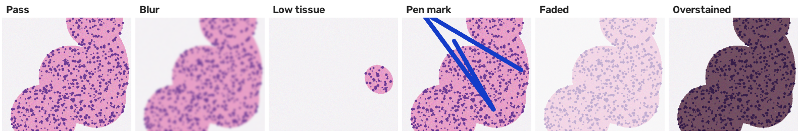
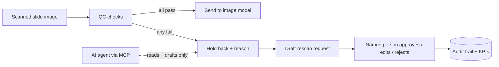

# SlideGuard

> A quality gate in front of pathology image models: it checks each scanned slide for blur, missing tissue, pen marks, and staining problems, holds bad slides back from automated analysis, and drafts a rescan request that a person approves.

**All images here are synthetic.** No real patient slides. The tiles are drawn to look H&E-like (pink tissue, purple nuclei) so the checks can be developed and tested end to end.



## Why

AI models that read routine pathology slides can predict genomic changes and risk directly from the image. But a model is only as good as its input: a blurry scan, a slide that caught mostly empty glass, or a marker line across the tissue can produce a confident answer that is wrong. SlideGuard is the gate that makes sure only fit images reach the model, and that every rejected slide gets a clear reason and a next step.

## How it works



| Check | What it measures | Fails when |
| --- | --- | --- |
| Tissue coverage | Share of the image that is stained tissue | Under 15% |
| Sharpness | Variance of the Laplacian inside the tissue | Under 250 |
| Pen marks | Share of pixels with marker-ink colors (green/blue/black) | Over 0.02% |
| Faded stain | Mean color saturation inside the tissue | Under 60 |
| Overstaining | Mean brightness inside the tissue | Under 150 |

Every failure explains itself, for example `blur: sharpness 66 (needs 250+)`, so a lab lead can see exactly why a slide was held back. Thresholds live in `slideguard/qc.py`.

## Production-grade by design

| Concern | How it's handled |
| --- | --- |
| Human-in-the-loop | Rescan requests are drafts; a named reviewer approves once, via CLI |
| Least privilege | MCP tools read and draft only; there is no approve or send tool |
| Auditability | QC results, drafts, approvals, rejections, and edits are logged with actor and time |
| Fail safe | An unreadable file fails QC instead of crashing or passing |
| Observability | QC runs log a structured JSON line (slides checked, failures, latency) |
| Evals as a release gate | Held-out golden set runs in CI; any bad slide passing fails the build |
| Bounded output | Agent-facing results capped at 50 |

## Evals

The thresholds were tuned on development data. `python evals/run_eval.py` then scores a **separate held-out set** (different random seed): 90 slides, 40 clean and 50 defective, with about half the defects in a subtle "mild" form (slight blur, a short ink tick, lightly faded stain).

| Metric | What it means | Gate | Result |
| --- | --- | --- | --- |
| False pass rate | Defective slide reached the model | 0% | **0%** |
| False fail rate | Clean slide wrongly held back | 5% max | **0%** |
| Reason accuracy | Failed slide tagged with the right reason | 95% min | **100%** |

**What tuning caught:** the first version flagged ink only when it covered 0.5% of the image, and it **missed every small ink tick** in the mild development set (0 of 20). Clean slides showed zero ink-colored pixels, so I lowered the limit to 0.02% and confirmed it raised **0 false alarms on 200 clean slides** while catching **40 of 40** subtle marks.

**Honest limits:** synthetic slides are cleaner than real ones. Real scans have dust, debris, tissue folds, and stain variation between labs, so on real data these thresholds would need re-tuning on labeled examples from the lab team, and a learned classifier might replace some checks. The workflow around the checks (hold back, explain, draft, approve, measure) stays the same.

## KPIs

`python -m slideguard.cli metrics`: slides checked, **QC fail rate**, **failures by reason** (which points at the root cause: a scanner needing service, a staining batch, a handling habit), rescan requests pending, **approval rate**, and **human edit rate** on drafted requests.

## Run it

```bash
python3 -m venv .venv && source .venv/bin/activate
pip install -r requirements-dev.txt

python -m slideguard.cli generate         # 44 synthetic demo slides in data/slides
python -m slideguard.cli check            # run QC on them
python -m slideguard.cli failed           # slides held back, with reasons
python -m slideguard.cli draft <slide_id> # draft a rescan request
python -m slideguard.cli pending          # requests waiting for a person
python -m slideguard.cli approve <request_id> --reviewer "Your Name"
python -m slideguard.cli metrics

pytest -q                                 # 19 unit tests
python evals/run_eval.py                  # eval gate
```

To check your own images: `python -m slideguard.cli check path/to/folder` (PNG or JPG).

### Connect the MCP server to Claude Desktop

```bash
pip install -r requirements-mcp.txt
```

Add to `~/Library/Application Support/Claude/claude_desktop_config.json` (absolute paths):

```json
{
  "mcpServers": {
    "slideguard": {
      "command": "/absolute/path/to/slideguard/.venv/bin/python",
      "args": ["/absolute/path/to/slideguard/mcp_server.py"]
    }
  }
}
```

Tools: `failed_slides`, `get_slide`, `draft_rescan_request`, `qc_metrics`. Try: *"Which slides failed QC, what's the most common reason, and draft rescan requests for the blurry ones."*

## Project layout

```
slideguard/    qc.py (checks), synth.py (synthetic slides), service.py, store.py, cli.py
mcp_server.py  agent-facing tools (read + draft only)
evals/         held-out eval with CI gates
tests/         unit tests
docs/          example image
```
